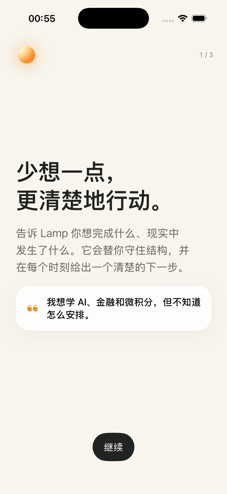
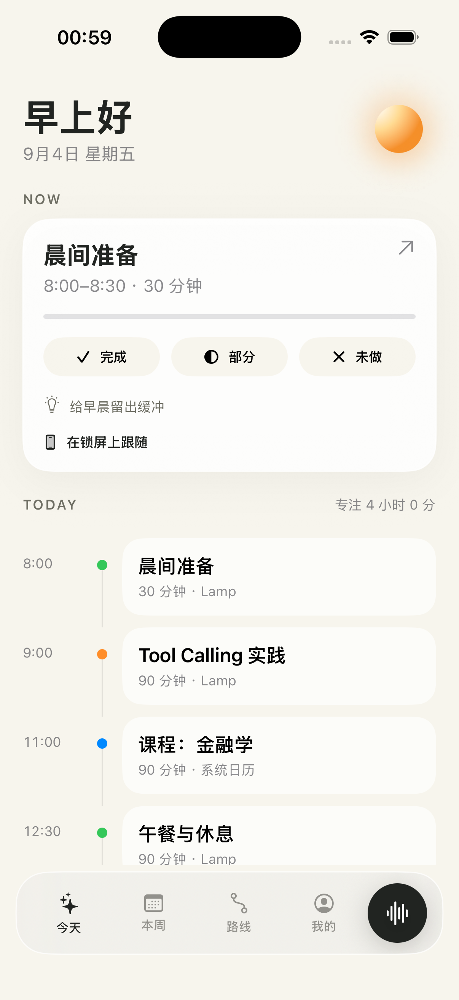

  <h1>Lamp</h1>
  
<strong>A personal planning agent for iPhone.</strong>

  
不是另一个聊天窗口，而是持续回答：我现在应该做什么？

  
  
  

[最新演示](#最新演示) · [应用界面](#应用界面) · [已实现](#已实现)

Lamp 是一个原生 SwiftUI iPhone 个人规划 Agent。它的核心不是聊天，而是持续回答：**我现在应该做什么？**

当前产品原型包含原生交互、确定性排程核心、Live Activity / Dynamic Island 扩展、App Shortcuts，以及已接通的 Supabase + DeepSeek 文字与图片日程链路。

## 最新演示

  
  
<strong>少想一点，更清楚地行动。</strong> 把想做的事，变成现在能做的一步。

  
<a href="docs/media/lamp-rollup-poster.png">查看完整易拉宝海报</a>

海报为产品理念与功能的创意展示；实际应用界面见下方原型截图。

## 应用界面

<table>
  <tr>
    <td width="50%"></td>
    <td width="50%"></td>
  </tr>
</table>

## 已实现

- 三步低摩擦 onboarding。
- Now + Today 主界面与固定/灵活/休息时间线。
- 完成、部分完成、未完成反馈和剩余时长更新。
- “日程”提供周／月／年三个时间层级，支持周期导航、长期目标、月度里程碑和周排程预览。
- 原生五栏底部导航，中央 Lamp 图标使用琥珀色突出且不遮挡内容。
- Tell Lamp：文字、中文语音转写、DeepSeek Vision 图片日程理解与本机 OCR 降级预览。
- 图片可先作为附件加入对话，再结合最多 1200 字的文字或语音说明进行识别；图文冲突会明确标记后交由用户确认。
- 图片候选可编辑、筛选并检查冲突，确认后一次性导入 Today / Week，整次操作可撤销。
- 固定、灵活、休息、重复日程以及周／月／年计划都可按明确范围删除并撤销；外部日历来源不会被改写。
- 每周重复日程、稳定 occurrence ID 与只影响单次的完成、跳过、改期 override。
- “今天很累”临时状态与可预览、确认的轻量重排。
- “Lamp 了解的你”：可查看、删除的记忆与可开关规则。
- 本地 JSON 离线持久化与演示数据。
- Live Activity / Dynamic Island 的倒计时、完成和部分完成控制。
- “打开今天”“告诉 Lamp”App Shortcuts。
- 混合排程引擎、24 个确定性核心测试与 17 条全流程 UI 自动化测试。
- 每晚睡眠自动排程与夜晚归属显示；睡眠卡片使用 7 帧舒缓循环插画，在降低动态效果或低电量模式下自动停在熟睡画面。
- Supabase 匿名认证、Postgres/RLS 数据模型和 DeepSeek 工具白名单、风险分类、幂等审计边界。

## 展示范围

本仓库仅包含作品介绍、精选截图、宣传海报与演示视频。项目源码、开发文档和服务端配置不公开。
